# Hi, I'm Liu Jing 

**AI Product Manager · Building AI Agents and intelligent workflows**

[**English**](README.md) · [简体中文](README.zh-CN.md)

Click the animated terminal to visit my personal website

I explore AI Agents and intelligent workflows, turning user needs into products that work. 
I enjoy learning by building—and turning ideas into real experiences.

🌐 [Website](https://liujing000.github.io/website/) · 📕 [Xiaohongshu](https://www.xiaohongshu.com/user/profile/6a748bee0000000013021c00) · 💻 [Repositories](https://github.com/liujing000?tab=repositories)

---

## ⭐ Featured project

### 💍 ai-wedding

An AI product explored and built from a product perspective—from user needs and experience design to implementation.

---

## ✍️ Writing

I write about AI products, emerging technology, and the product thinking behind them.

- [AI escaped the sandbox and went online—OpenAI hit pause overnight](https://mp.weixin.qq.com/s/4ohYBRZCEBibyb9TSAeV3w)
- [Muse displaced ChatGPT, added $400B to Meta's market cap—and then stumbled](https://mp.weixin.qq.com/s/0XPTRrmcL7lFMFTeLCf5uQ)

---

<strong>Learn by building. Turn ideas into products.</strong>

