# 你好，我是刘静 

**AI 产品经理 · 探索 AI Agent 与智能工作流**

[English](README.md) · [**简体中文**](README.zh-CN.md)

点击动态终端，访问我的个人网站

我关注 AI Agent 与智能工作流，把用户需求一步步变成真正可用的产品。 
喜欢动手实践，在构建中学习，把想法做成体验。

🌐 [个人网站](https://liujing000.github.io/website/) · 📕 [小红书](https://www.xiaohongshu.com/user/profile/6a748bee0000000013021c00) · 💻 [全部项目](https://github.com/liujing000?tab=repositories)

---

## ⭐ 精选项目

### 💍 ai-wedding

从产品视角出发探索并构建的 AI 项目，覆盖用户需求、体验设计与产品落地。

---

## ✍️ 写作

我持续记录 AI 产品、新兴技术，以及它们背后的产品思考。

- [AI 偷偷爬出沙盒自己上网，OpenAI 连夜按下了暂停键](https://mp.weixin.qq.com/s/4ohYBRZCEBibyb9TSAeV3w)
- [Muse 把 ChatGPT 挤下神坛，Meta 市值暴涨 4000 亿，然后它翻车了](https://mp.weixin.qq.com/s/0XPTRrmcL7lFMFTeLCf5uQ)

---

<strong>在实践中学习，把想法做成产品。</strong>

